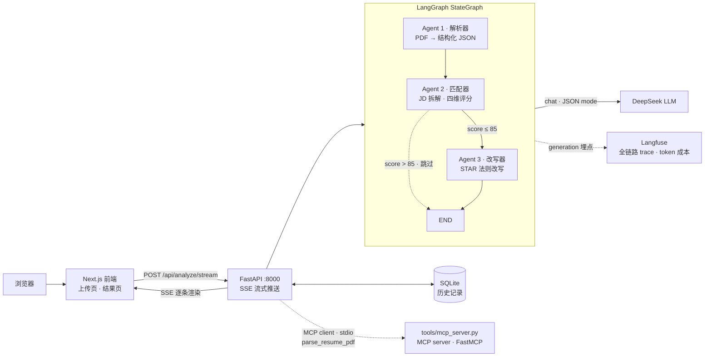

# ResumePilot · 简历优化多 Agent 工具

上传简历 PDF + 粘贴目标岗位 JD → 三个 Agent 协作 → 匹配度评分 + 逐段改写建议（STAR 法则，SSE 流式渲染）。

[]() []() []()

## 架构

```
浏览器 ──HTTP──> Next.js 前端 ──POST /api/analyze──> FastAPI ──graph.ainvoke──> LangGraph StateGraph ──chat/JSON mode──> DeepSeek LLM
   ▲                 :3000          ▲                    :8000        │                          │
   └──────── SSE 流式逐字渲染 ───────┘                                  │              Parser → Matcher → Rewriter
                                          SQLite（历史记录，session 粒度）◄┘              条件边：score > 85 跳过 Rewriter
```



**为什么用 LangGraph 图编排而不是顺序调用**：节点间通过共享 State 传递数据；条件边声明式表达"高匹配度跳过改写"（省一次无效 LLM 调用）；每个节点执行路径与耗时落入 trace（可观测性）；未来加 Agent 只需 `add_node` + 接边，不改主干。

**评分模型**：总分 = 硬技能 40% + 项目经历 30% + 学历门槛 15% + 加分项 15%（权重常量可配置，见 `backend/app/schemas.py`）。**总分由代码加权计算，不信 LLM 算术**；每条判定附简历原文证据，可解释。

## 选型理由（面试必问四条）

1. **为什么 LangGraph 不是 CrewAI / OpenAI Agents SDK**：编排框架选型是控制流决策不是功能决策——需要显式状态图 + 条件边 + checkpoint，LangGraph 是生产标准；CrewAI 把编排细节藏起来，面试"讲清控制流"反而吃亏。
2. **为什么 MCP**：把 `parse_resume_pdf` 封装成独立 MCP server（FastMCP），主程序以标准协议 client 调用——工具与编排解耦，任何 MCP 客户端（Claude Desktop 等）可复用。MCP 是 AI 的 USB-C。
3. **为什么 Langfuse 不是 LangSmith**：开源自部署、框架无关（FastAPI 裸调用也能埋点）、进 docker compose 零成本。
4. **为什么不上 A2A**：三 Agent 同进程协作用不上跨系统协议——知道边界比堆技术更重要。

## 已知缺陷（敢说拍的也是真实）

- 评分权重（40/30/15/15）是拍的，未经数据校准；阈值 85 同样
- 同一 JD 两次拆解的条数不稳定（LLM 粒度自由度），v3 候选修复：要求原子化约束
- 无 OCR：图片型 PDF 直接 422 拒绝（边界清晰是设计决策，不是没做）
- 历史记录 session 粒度无用户体系（浏览器 localStorage UUID）

## 技术栈

| 层 | 选型 |
|---|---|
| 前端 | Next.js 15（App Router）· Tailwind CSS 4 |
| 后端 | FastAPI · Uvicorn · SSE |
| Agent 编排 | LangGraph（StateGraph 三节点 + 条件边） |
| 工具协议 | **MCP**（FastMCP，`tools/mcp_server.py` 独立进程，主程序以 client 调用，失败自动降级进程内直调） |
| 可观测性 | **Langfuse**（自部署 docker-compose，未配置 key 自动关闭） |
| LLM | DeepSeek（OpenAI 兼容协议，JSON mode 结构化输出 + Pydantic 校验） |
| 存储 | SQLite（按 session ID，无登录） |
| 部署 | Docker Compose（含 Langfuse 服务栈） |

## 快速开始

```bash
# 后端（:8000）
cd backend
python -m venv .venv
.venv\Scripts\pip install -r requirements.txt   # Windows
copy .env.example .env                           # 填入 DEEPSEEK_API_KEY（不填则跑 stub 模式）
.venv\Scripts\python run.py

# 前端（:3000）
cd frontend
npm install
npm run dev
```

打开 http://127.0.0.1:3000 —— 页面会实时探测后端状态；无 API key 时三个 Agent 以 stub 数据完整跑通流水线。

**Docker 一键启动**（含 Langfuse 可观测栈）：

```bash
cp .env.example .env           # 填 DEEPSEEK_API_KEY（不填则 stub 模式）
docker compose up -d backend frontend
# 前端 http://localhost:3080 · 后端 http://localhost:8000
# 可选：docker compose up -d（含 Langfuse :3001，建项目后把 key 填进 .env）
```

**测试与验收**：

```bash
cd backend
.venv\Scripts\python -m pytest tests/ -q          # 单元测试 12/12（stub，0 成本）
.venv\Scripts\python -X utf8 tests/run_e2e.py     # 真实 3-JD 全流程回归（需 key，约 ¥0.02/次）
```

**验收实录**（2026-10-16，真实简历 × 3 JD，DeepSeek 真机）：

| JD | 总分 | 要求拆解 | 改写建议 | 全程 |
|---|---|---|---|---|
| AI Agent 开发实习 | 19.0 | 7 条 | 6 条 | 8.4s |
| Python 后端实习 | 18.2 | 12 条 | 6 条 | 7.8s |
| 数据分析实习（教育） | 25.5 | 12 条 | 6 条 | 8.1s |

评分符合直觉：数学背景 + 量化教学成果对数据分析 JD 最匹配（最高分）；无 LangChain/FastAPI 项目证据的 Agent JD 低分——"只认纸面证据"原则的直接体现。详见 `docs/prompt-iterations.md`。

**骨架验收（D1）**：

```bash
curl http://127.0.0.1:8000/health          # {"status":"ok",...}
curl http://127.0.0.1:3000/api/health      # {"status":"ok","backend":{"ok":true}}
curl http://127.0.0.1:8000/ping/frontend   # {"ok":true,"frontend_says":{...}}
curl -X POST http://127.0.0.1:8000/api/analyze -H "Content-Type: application/json" -d "{}"
```

## 路线图（7 天冲刺 · 10/20 ~ 10/26）

- [x] **D1** 仓库初始化 · 前后端骨架互相 ping 通 · LangGraph 图骨架（stub LLM）
- [x] **D2** Agent 1：pdfplumber 解析 + Pydantic 校验重试（`POST /api/parse`，含扫描件 422 边界、双栏布局警告）
- [x] **D3** Agent 2：JD 拆解 + 逐条比对 + 四维加权评分（`POST /api/match`，总分代码计算、证据引用、status 枚举校验）
- [x] **D4** Agent 3 + SSE 流式 + 三 Agent 串联（`POST /api/analyze/stream`，条目级并发流式、条件边、queue 侧信道）
- [x] **D5** 前端两页：上传页（拖拽上传 + JD 粘贴）+ 结果页（总分仪表盘 + 四维雷达 + 逐条对照 + 流式改写卡片）
- [x] **D6** Docker Compose（backend/frontend/Langfuse 栈）+ SQLite 历史记录（session 粒度）
- [x] **D7** README 定稿 + 真实简历 × 3 JD 全流程实测（`tests/run_e2e.py` 一键回归）
- [ ] **D3** Agent 2：JD 拆解 + 四维评分 + 证据引用
- [ ] **D4** Agent 3 + SSE 流式 + 条件边实测
- [ ] **D5** 前端两页：上传页 + 结果页（评分卡/雷达/逐段对照）
- [ ] **D6** Docker Compose + 部署上线
- [ ] **D7** README 打磨 + 真实简历 × 3 JD 全流程测试

## 项目结构

```
backend/
  app/
    main.py            # FastAPI 入口：/health /ping/frontend /api/parse /api/match /api/analyze(/stream)
    config.py          # 环境变量配置
    llm.py             # LLM 封装：stub 模式 / JSON mode / 解析重试
    pdf.py             # pdfplumber 提取：扫描件拒绝、双栏布局警告
    schemas.py         # Pydantic 契约 + 评分权重常量
    mcp_client.py      # MCP client：stdio 连接工具 server，失败降级进程内直调
    observability.py   # Langfuse 埋点：trace/generation，未配置自动关闭
    agents/            # 三个 Agent（parser / matcher / rewriter）
    graph/workflow.py  # LangGraph StateGraph 编排 + 条件边
  tools/
    mcp_server.py      # MCP server（FastMCP）：parse_resume_pdf 工具，独立进程
  tests/
    run_e2e.py          # 3-JD 全流程真机回归（一键）
    fixtures/           # 测试简历 PDF + 3 个真实 JD 文本
    test_*.py           # pytest 12 例（stub，0 成本）
frontend/
  app/                 # Next.js App Router：/（上传页）+ /result（结果页）+ /api/health
  components/          # ScoreGauge 仪表盘 · RadarChart 雷达 · RequirementList 对照表 · RewriteCard 建议卡片
  lib/                 # 类型契约 · SSE 客户端（fetch 流式）· 分析状态 store
docs/
  prompt-iterations.md # prompt 迭代日志（面试铁证）
```
