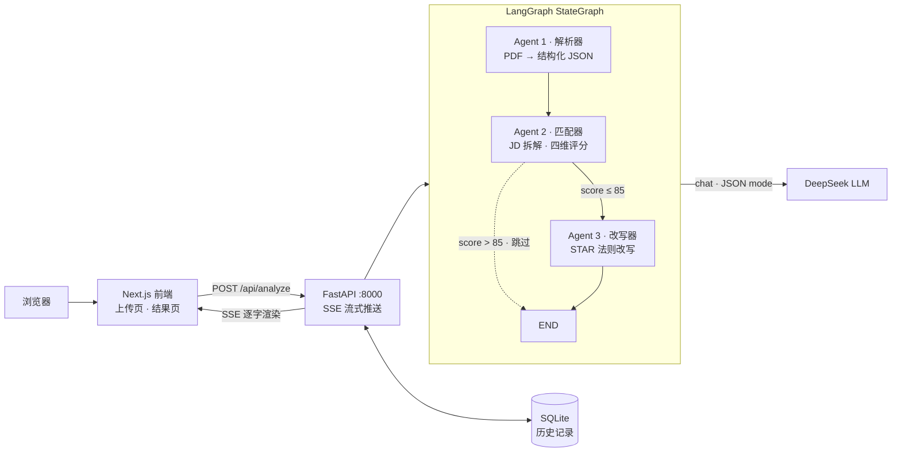

# ResumePilot · 简历优化多 Agent 工具

上传简历 + 粘贴目标岗位 JD → 三个 Agent 协作 → 匹配度评分 + 逐段改写建议（STAR 法则，SSE 流式渲染）。

## 架构

```
浏览器 ──HTTP──> Next.js 前端 ──POST /api/analyze──> FastAPI ──graph.ainvoke──> LangGraph StateGraph ──chat/JSON mode──> DeepSeek LLM
   ▲                 :3000          ▲                    :8000        │                          │
   └──────── SSE 流式逐字渲染 ───────┘                                  │              Parser → Matcher → Rewriter
                                          SQLite（历史记录，session 粒度）◄┘              条件边：score > 85 跳过 Rewriter
```



**为什么用 LangGraph 图编排而不是顺序调用**：节点间通过共享 State 传递数据；条件边声明式表达"高匹配度跳过改写"（省一次无效 LLM 调用）；每个节点执行路径与耗时落入 trace（可观测性）；未来加 Agent 只需 `add_node` + 接边，不改主干。

**评分模型**：总分 = 硬技能 40% + 项目经历 30% + 学历门槛 15% + 加分项 15%（权重常量可配置，见 `backend/app/schemas.py`）。

## 技术栈

| 层 | 选型 |
|---|---|
| 前端 | Next.js 15（App Router）· Tailwind CSS 4 |
| 后端 | FastAPI · Uvicorn |
| Agent 编排 | LangGraph（StateGraph 三节点 + 条件边） |
| LLM | DeepSeek（OpenAI 兼容协议，JSON mode 结构化输出 + Pydantic 校验） |
| 存储 | SQLite（按 session ID，无登录） |
| 部署 | Docker Compose（D6 接入） |

## 快速开始

```bash
# 后端（:8000）
cd backend
python -m venv .venv
.venv\Scripts\pip install -r requirements.txt   # Windows
copy .env.example .env                           # 填入 DEEPSEEK_API_KEY（不填则跑 stub 模式）
.venv\Scripts\python run.py

# 前端（:3000）
cd frontend
npm install
npm run dev
```

打开 http://127.0.0.1:3000 —— 页面会实时探测后端状态；无 API key 时三个 Agent 以 stub 数据完整跑通流水线。

**骨架验收（D1）**：

```bash
curl http://127.0.0.1:8000/health          # {"status":"ok",...}
curl http://127.0.0.1:3000/api/health      # {"status":"ok","backend":{"ok":true}}
curl http://127.0.0.1:8000/ping/frontend   # {"ok":true,"frontend_says":{...}}
curl -X POST http://127.0.0.1:8000/api/analyze -H "Content-Type: application/json" -d "{}"
```

## 路线图（7 天冲刺 · 10/20 ~ 10/26）

- [x] **D1** 仓库初始化 · 前后端骨架互相 ping 通 · LangGraph 图骨架（stub LLM）
- [x] **D2** Agent 1：pdfplumber 解析 + Pydantic 校验重试（`POST /api/parse`，含扫描件 422 边界、双栏布局警告）
- [ ] **D3** Agent 2：JD 拆解 + 四维评分 + 证据引用
- [ ] **D4** Agent 3 + SSE 流式 + 条件边实测
- [ ] **D5** 前端两页：上传页 + 结果页（评分卡/雷达/逐段对照）
- [ ] **D6** Docker Compose + 部署上线
- [ ] **D7** README 打磨 + 真实简历 × 3 JD 全流程测试

## 项目结构

```
backend/
  app/
    main.py            # FastAPI 入口：/health /ping/frontend /api/parse /api/analyze
    config.py          # 环境变量配置
    llm.py             # LLM 封装：stub 模式 / JSON mode / 解析重试
    pdf.py             # pdfplumber 提取：扫描件拒绝、双栏布局警告
    schemas.py         # Pydantic 契约 + 评分权重常量
    agents/            # 三个 Agent（parser / matcher / rewriter）
    graph/workflow.py  # LangGraph StateGraph 编排 + 条件边
  tests/               # pytest（PDF 提取 / 边界 / 契约）
frontend/
  app/                 # Next.js App Router（page + /api/health）
  components/          # BackendStatus 后端探测卡片
docs/
  prompt-iterations.md # prompt 迭代日志（面试铁证）
```
