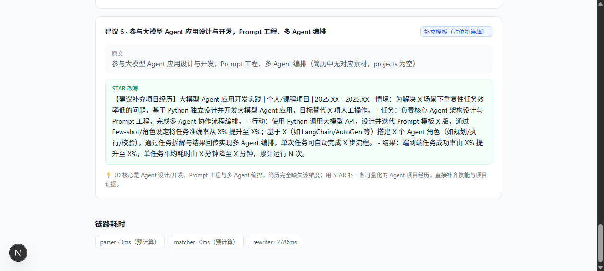
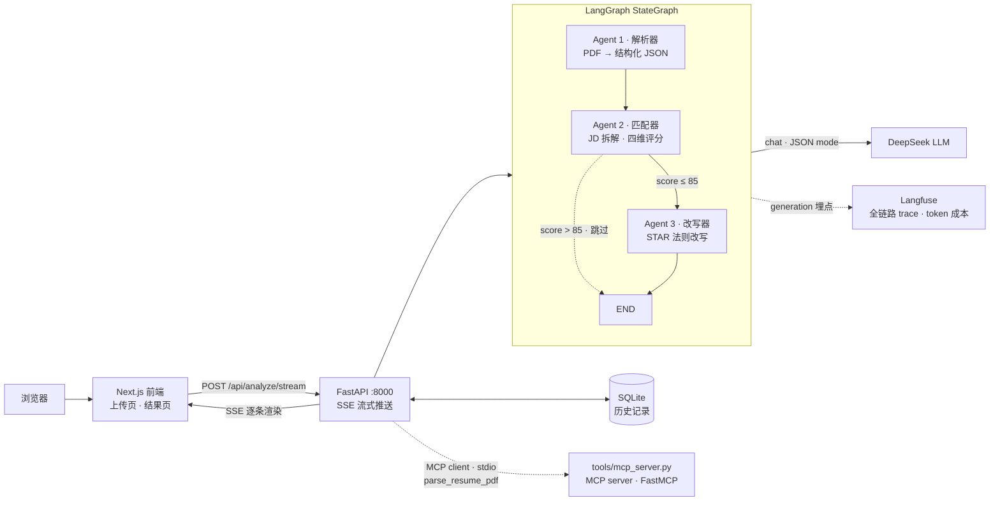

# ResumePilot · 简历优化多 Agent 工具

上传简历 PDF + 粘贴目标岗位 JD → 三个 Agent 协作 → 匹配度评分 + 逐段改写建议（STAR 法则，SSE 流式渲染）。



[]()
[-9b59b6)]()
[]()
[]()
[]()
[]()
[]()

## 它解决什么问题

投简历前，你不知道自己的简历跟目标 JD 差在哪：哪些要求命中了、哪些沾边、哪些完全没写。人肉逐条比对费时且主观。

ResumePilot 把这件事交给三个职责单一的 Agent：

```
[上传 PDF + 粘贴 JD]
    ↓
Agent 1 解析器 —— 简历 → 结构化 JSON（教育/经历/技能/项目）
    ↓
Agent 2 匹配器 —— JD 拆解为要求清单 → 逐条比对 → 四维加权评分（每条附简历原文证据）
    ↓ (总分 > 85 ? 条件边：跳过改写，省钱)
Agent 3 改写器 —— 对不达标条目给 STAR 法则改写文案（条目级并发流式推送）
    ↓
[结果页：总分仪表盘 + 维度雷达 + 逐条对照 + 改写建议]
```

**设计原则**：评分只认纸面证据（每条判定引用简历原文，可解释）；改写不编造（缺失项只给占位符模板，量化数字必须来自简历或由用户填入）。

## 架构



## 技术选型（为什么这么选）

| 决策 | 选了什么 | 为什么 |
|---|---|---|
| Agent 编排 | LangGraph StateGraph | 编排框架选型是**控制流决策**：需要显式状态图 + 条件边 + 可恢复执行，LangGraph 是当前生产标准；CrewAI 把控制流藏进角色隐喻，"讲不清怎么跑的"对工程面试是减分 |
| 工具协议 | MCP（FastMCP） | 把 `parse_resume_pdf` 封装为独立 MCP server，主程序以标准协议 client 调用——工具与编排解耦，任何 MCP 客户端（Claude Desktop 等）可直接复用。MCP 是 AI 工具层的 USB-C |
| 结构化输出 | JSON mode + Pydantic 校验 + 失败重试 | LLM 输出不可信是工程前提：双层校验（JSON 解析 + Pydantic 契约），校验错误喂回模型自纠，最多重试 2 次 |
| 流式方案 | 条目级并发 SSE | JSON 结构化输出与 token 级流式天然冲突（JSON 未闭合无法解析）→ 每条建议独立 LLM 调用 + `asyncio.gather` 并发，完成一条推一条——比串行快 N 倍，比 token 流式可靠 |
| 可观测 | Langfuse 自部署 | 开源、框架无关（FastAPI 裸调用可埋点）、进 compose 零成本；每 Agent 节点一个 generation（token/延迟/prompt 版本），未配置 key 自动零开销关闭 |
| 总分计算 | 代码加权，不信 LLM 算术 | LLM 数学不可靠是共识；权重常量（硬技能 40% / 项目 30% / 学历 15% / 加分 15%）放代码里可配置 |
| 不上 A2A | — | 三 Agent 同进程协作，用不上跨系统协议——**知道边界比堆技术更重要** |

## 快速开始

**本地开发**：

```bash
# 后端 :8000
cd backend
python -m venv .venv && .venv\Scripts\pip install -r requirements.txt
copy .env.example .env          # 填 DEEPSEEK_API_KEY（不填自动进 stub 模式，零成本跑通全流程）
.venv\Scripts\python run.py

# 前端 :3000
cd frontend
npm install && npm run dev
```

**Docker 一键启动**：

```bash
cp .env.example .env
docker compose up -d backend frontend
# 前端 http://localhost:3080 · 后端 http://localhost:8000
# 完整栈（含 Langfuse :3001）：docker compose up -d
```

## API

| 端点 | 说明 |
|---|---|
| `POST /api/parse` | 上传 PDF → 结构化 JSON（经 MCP server，扫描件 422 拒绝，双栏布局告警） |
| `POST /api/match` | 简历 JSON + JD → 四维评分 + 逐条证据 |
| `POST /api/analyze/stream` | **全流程 SSE**：progress / resume / match / rewrite（逐条推送）/ trace / done |
| `GET /api/history?session_id=` | 历史记录（session 粒度，无登录体系） |

```bash
# 流式全流程体验
curl -N -X POST http://127.0.0.1:8000/api/analyze/stream \
  -F "file=@my_resume.pdf" -F "jd_text=<jd.txt" -F "session_id=demo"
```

## 测试与验证

```bash
cd backend
.venv\Scripts\python -m pytest tests/ -q            # 12 个单元测试（stub 模式，零 API 成本）
.venv\Scripts\python -X utf8 tests/run_e2e.py       # 3 个真实 JD 全流程回归（约 ¥0.02/次）
```

**真实简历 × 3 JD 实测**（DeepSeek 真机，一键复现：`run_e2e.py`）：

| JD 类型 | 总分 | 要求拆解 | 改写建议 | 全程耗时 |
|---|---|---|---|---|
| AI Agent 开发 | 19.0 | 7 条 | 6 条 | 8.4s |
| Python 后端 | 18.2 | 12 条 | 6 条 | 7.8s |
| 数据分析（教育） | 25.5 | 12 条 | 6 条 | 8.1s |

评分与直觉一致：数学背景 + 量化教学成果（92→118 分）对数据分析 JD 最匹配；无 LangChain 项目证据的 JD 得低分——"只认纸面证据"原则的直接体现。prompt 迭代过程与已知问题全部记录在 [docs/prompt-iterations.md](docs/prompt-iterations.md)。

## 工程实践亮点

- **平滑协议化改造**：MCP client 连接失败自动降级进程内直调，协议迁移不停服
- **流式可靠性**：`asyncio.wait(FIRST_COMPLETED)` 竞争监听图任务与推送队列，图异常立即冒出（不让 `create_task` 吞异常导致流挂死——真踩过的坑）
- **LLM 错误分级**：402 余额 / 401 鉴权 / 超时映射为语义化 HTTP 响应，前端可引导用户
- **零成本开发回路**：stub 模式让全流程（含 SSE 流式）在无 key、无网环境可跑，真机验证只在验收时做
- **分层测试策略**：单元测试全 stub（零 API 成本、CI 友好）、E2E 用真 key 但控制频率（约 ¥0.02/次）、测试 fixtures 入库保证可复现

## Roadmap

- [ ] v1.1 条件边阈值基于真实反馈校准（当前 85 为经验值）
- [ ] v1.1 JD 拆解原子化约束（修复两次拆解粒度不一致：7 vs 14 条）
- [ ] v1.2 Langfuse 全量激活 + 成本看板（token/次分析）
- [ ] v1.2 多简历对比（同 JD 下不同版本简历评分 diff）
- [ ] v1.3 OCR 扫描件支持（当前明确拒绝并提示，边界即设计）

## 已知限制

评分权重未经数据校准（拍的，敢说）；图片型 PDF 不做 OCR（422 拒绝）；历史记录 session 粒度无用户体系（localStorage UUID）。

## 项目结构

```
backend/
  app/
    main.py            # FastAPI：/health /ping/frontend /api/parse /api/match /api/analyze(/stream) /api/history
    graph/workflow.py  # LangGraph StateGraph：三节点 + 条件边 + RunnableConfig 流式侧信道
    agents/            # parser / matcher / rewriter（各自独立 prompt + Pydantic 契约 + 重试）
    mcp_client.py      # MCP client（stdio），失败降级进程内直调
    observability.py   # Langfuse 埋点（trace/generation），未配置自动关闭
    pdf.py             # pdfplumber 提取：扫描件拒绝、双栏告警
    db.py              # SQLite 历史（asyncio.to_thread 包装）
    llm.py             # LLM 封装：JSON mode / 解析重试 / stub 模式
    schemas.py         # Pydantic 契约 + 评分权重常量
  tools/mcp_server.py  # MCP server（FastMCP）：parse_resume_pdf 工具，独立进程
  tests/               # pytest 12 例 + run_e2e.py 3-JD 真机回归 + fixtures
frontend/
  app/                 # 上传页 / + 结果页 /result
  components/          # ScoreGauge / RadarChart（纯 SVG 零依赖）/ RequirementList / RewriteCard
  lib/                 # SSE 客户端（fetch POST 流式）/ 状态 store / 类型契约
docs/
  prompt-iterations.md # prompt 迭代日志：v1→v2 改动、实测数据、踩坑记录
docker-compose.yml     # backend + frontend + Langfuse 栈
```
